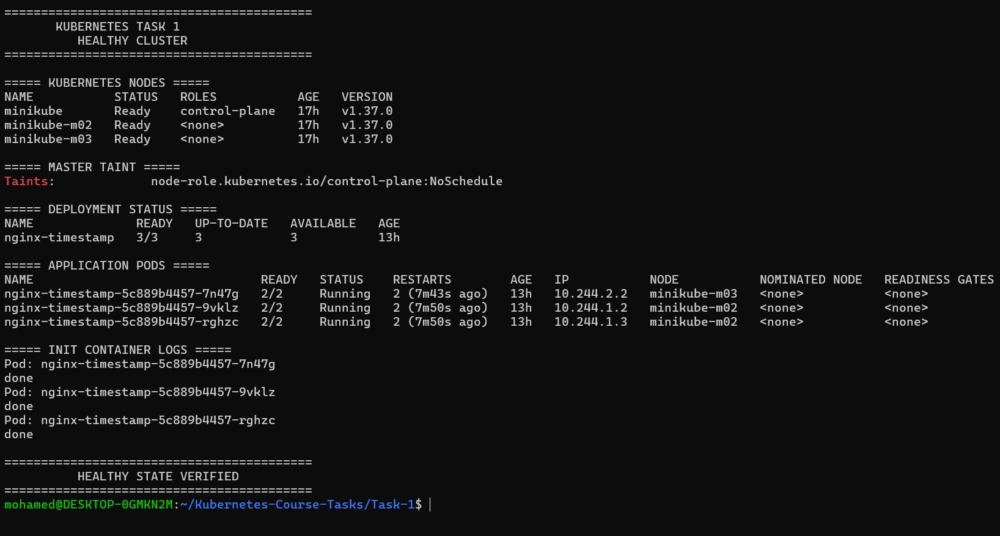
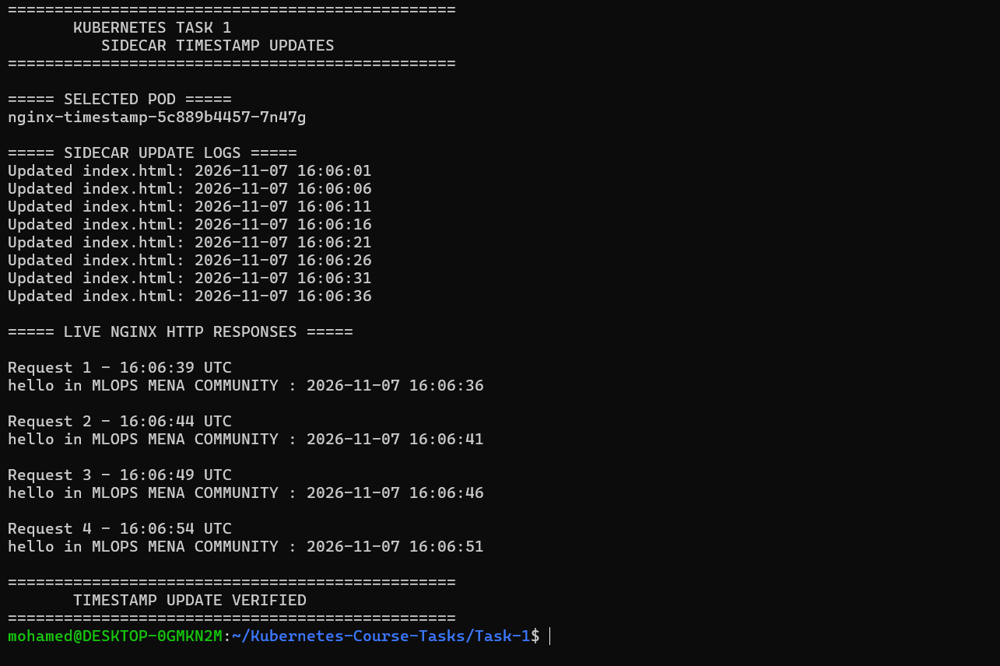
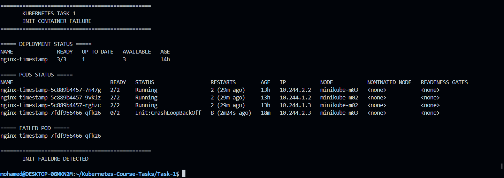
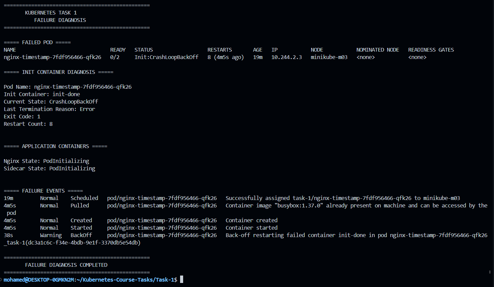
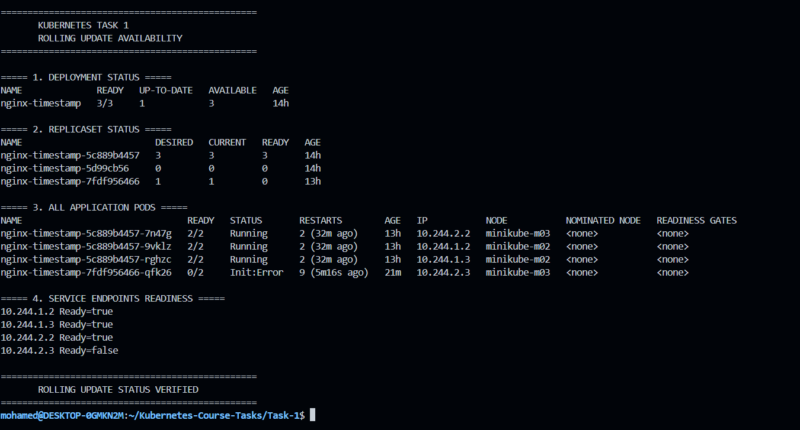
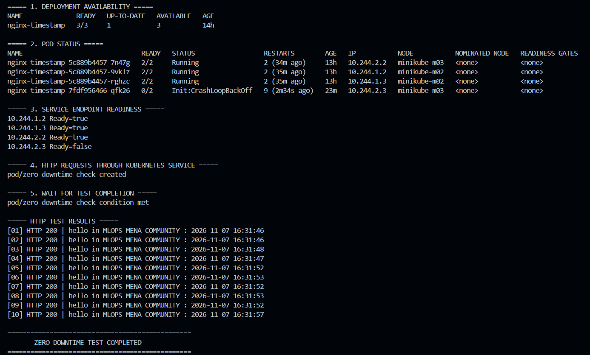
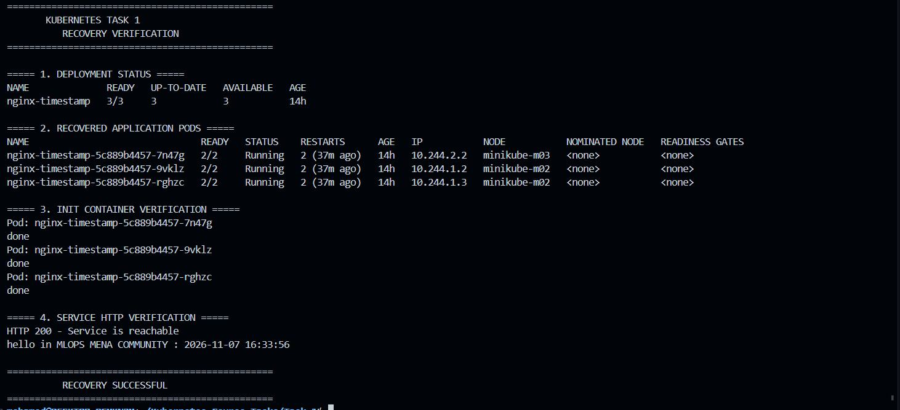

# Task 1: Multi-Container Pods (Init Container & Sidecar)

## Overview

This task demonstrates deploying a multi-container Nginx application on a 3-node Minikube cluster.

Each Pod contains:
- **init-done:** An Init Container that must complete successfully before the application starts.
- **nginx:** The main container serving an HTML page with the current timestamp.
- **time-updater:** A Sidecar Container that updates the timestamp every 5 seconds.

The Pod uses `shareProcessNamespace: true` and does not use application-defined shared volumes.

---

## 1. Healthy Cluster Deployment

**Status:** Successful

Three Kubernetes Nodes were configured, and three application Pods were deployed successfully across the two Worker Nodes.



**Concept:** Kubernetes Deployment and ReplicaSets maintain the desired number of running Pod replicas.

## 2. Timestamp Updates

**Status:** Successful

The Nginx page displays the community Hello message with the current timestamp. The Sidecar successfully updates the page every 5 seconds.



**Concept:** Sidecar Containers can perform supporting tasks alongside the main application within the same Pod.

## 3. Init Container Failure

**Status:** Failure Successfully Simulated

The `init-done` container was intentionally configured to exit with code `1`, causing the new Pod to enter `Init:CrashLoopBackOff`.



**Concept:** Init Containers must complete successfully before the application containers can start.

## 4. Failure Diagnosis

**Status:** Failure Diagnosed

The failed Pod was inspected, confirming `Exit Code: 1`, repeated restart attempts, and the fact that Nginx and the Sidecar remained unstarted.



**Concept:** Kubernetes events, container states, and restart counts help identify and diagnose application failures.

## 5. Rolling Update Availability

**Status:** Old Replicas Preserved

The old ReplicaSet maintained three available Pods while the new ReplicaSet contained one failing Pod.

The Service continued to have three ready endpoints, while the failed Pod remained unready.



**Concept:** Rolling Updates with `maxUnavailable: 0` help preserve application availability while introducing a new version.

## 6. Zero Downtime Verification

**Status:** Successful

Ten consecutive HTTP requests were sent through the Kubernetes Service during the failure scenario.

- Total Requests: 10
- Successful Requests: 10
- Failed Requests: 0
- Success Rate: 100%



**Concept:** Kubernetes Services route traffic to ready application endpoints, excluding Pods that are not ready.

## 7. Application Recovery

**Status:** Successful

The Init Container configuration was restored to `echo done`. The Deployment successfully recovered and returned to three available replicas.

The Nginx Service was also verified with an HTTP 200 response.



**Concept:** Updating the Deployment back to a healthy configuration allows Kubernetes to complete the rollout and restore the desired application state.

---

## Project Structure

```text
Task-1/
├── deployment-01-healthy.yaml
├── deployment-02-init-failure.yaml
├── deployment-03-recovery.yaml
├── service.yaml
├── README.md
└── screenshots/
    ├── 01-cluster-healthy.png
    ├── 02-timestamp-updates.png
    ├── 03-init-container-failure.png
    ├── 04-failure-diagnosis.png
    ├── 05-rolling-update-availability.png
    ├── 06-zero-downtime-test.png
    └── 07-recovery.png
```

## Technologies Used

- Kubernetes
- Minikube
- Docker
- Containerd
- Nginx
- BusyBox
- kubectl

**Course:** MLOps MENA Community  
**Task:** Session 1 - Multi-Container Pods (Init Container & Sidecar)